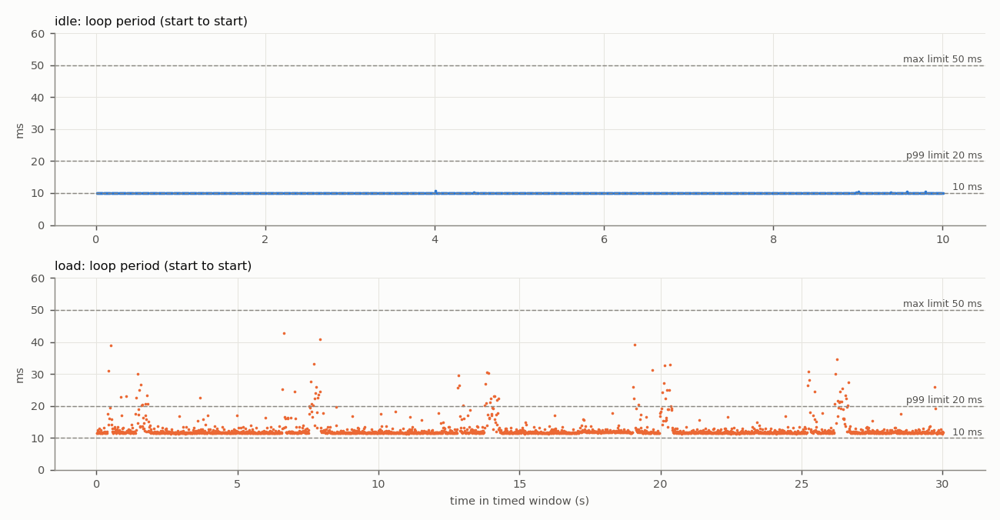
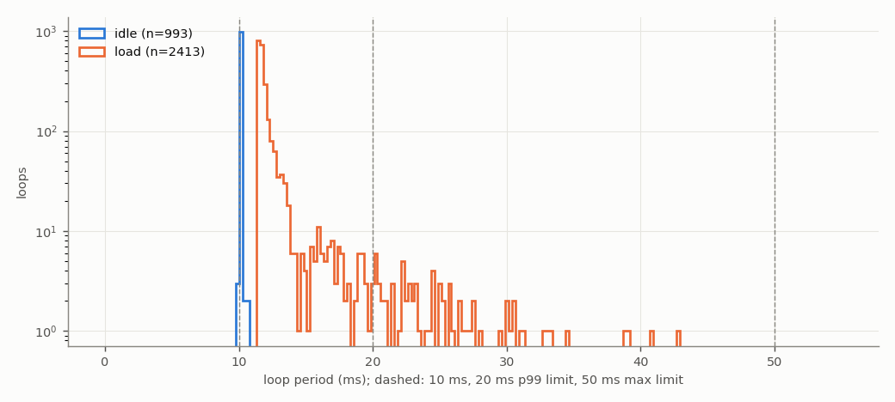
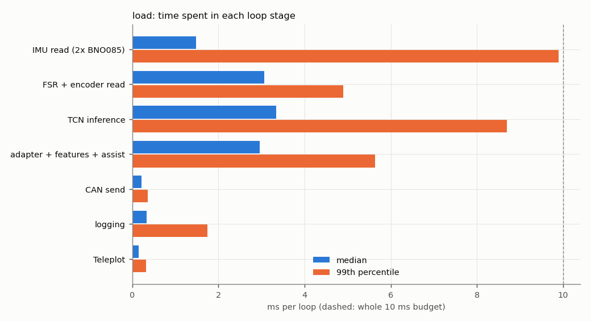
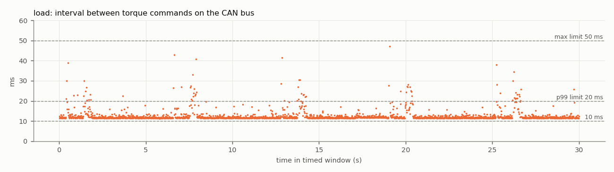

# Test 4 — Control loop and CAN command rate

**Verdict (load run): FAIL**

- Run: `/home/axilles/exo_ws/fall_test_plan/test_4/results/20261027_172942/load`
- **SIMULATED SENSORS**: no sensors attached; sensor reads are placeholder waits ({'imu_both': 1.4, 'fsr_enc': 3.0} ms). CAN bus, motor, TCN, safety checks and logging are real. Re-run with the sensors connected for the final result.
- Controller: TCN `/home/axilles/exo_ws/ML_model/runs/deploy`, backend `onnx`; torque mode `zero`; scheduler `relative`; gait injection on
- Jetson: NVIDIA Jetson Orin Nano Engineering Reference Developer Kit Super; NV Power Mode: 25W; governor ['schedutil']; git 48144390 (axilles-154-Test4-Control-Loop-CAN-Command-rate)

| Criterion | Measured | Limit | Result |
|---|---|---|---|
| Mean loop rate | 80.4148 Hz | >= 100 Hz | **FAIL** |
| 99th-percentile period | 25.92 ms | <= 20 ms | **FAIL** |
| Largest period | 42.88 ms | <= 50 ms | **PASS** |
| CAN torque-command rate (on wire) | 80.4123 Hz | >= 100 Hz | **FAIL** |
| No controller restart | completed | single run, completed | **PASS** |
| No log or frame loss | none | none | **PASS** |
| No out-of-memory event | none | none | **PASS** |


**Diagnosis**

- The loop work alone takes 11.65 ms (median) of the 10 ms budget. Largest stages (median): TCN inference 3.33 ms, FSR + encoder read 3.06 ms, adapter + features + assist 2.96 ms, IMU read (2x BNO085) 1.48 ms.
- Largest single-stage spikes: IMU read (2x BNO085) 27.2 ms (p99 9.9), TCN inference 24.2 ms (p99 8.7), adapter + features + assist 17.0 ms (p99 5.6).

## Script output

| Metric | idle | load |
|---|---|---|
| Timed loops | 993 | 2413 |
| Window (s) | 10.0 | 30.0 |
| Mean loop rate (Hz) | 99.2890 | 80.4148 |
| Median period (ms) | 10.067 | 11.662 |
| 99th-pct period (ms) | 10.104 | 25.917 |
| Largest period (ms) | 10.656 | 42.880 |
| Periods > 10 ms (%) | 100.000 | 100.000 |
| Periods > 20 ms (%) | 0.000 | 3.067 |
| Loop work > 10 ms (%) | 0.000 | 100.000 |
| Loop work > 20 ms (%) | 0.000 | 3.025 |
| Periods > 50 ms | 0 | 0 |
| Loop work p50 / p99 (ms) | 0.01 / 0.03 | 11.65 / 25.90 |
| CAN cmd rate, wire (Hz) | — | 80.41 |
| CAN cmd rate, in-process (Hz) | — | 80.41 |
| CAN cmd interval p99 / max (ms) | — | 26.67 / 47.21 |
| Motor reply rate (Hz) | — | 49.96 |
| Bus error frames | — | 0 |
| Watchdog trips | 0 | 19 |
| RSS start / max (MB) | 540 / 541 | 540 / 701 |
| Min MemAvailable (MB) | 3658 | 3554 |
| Max CPU temp (°C) | 45.0 | 47.6 |
| CPU freq min / max (MHz) | 730 / 1344 | 730 / 1344 |

## Where the loop time goes (load run, ms)

| Stage | mean | p50 | p99 | max |
|---|---|---|---|---|
| IMU read (2x BNO085) | 1.712 | 1.475 | 9.893 | 27.151 |
| FSR + encoder read | 3.118 | 3.060 | 4.892 | 10.992 |
| TCN inference | 3.597 | 3.332 | 8.693 | 24.176 |
| adapter + features + assist | 3.121 | 2.959 | 5.634 | 16.974 |
| CAN send | 0.224 | 0.214 | 0.355 | 4.960 |
| logging | 0.465 | 0.334 | 1.740 | 16.062 |
| Teleplot | 0.154 | 0.142 | 0.318 | 7.181 |

Five longest periods (load run):

| t (s) | period | loop work | step | TCN | IMU | FSR+enc | send |
|---|---|---|---|---|---|---|---|
| 6.6 | 42.88 | 42.87 | 6.69 | 3.36 | 14.90 | 3.10 | 0.21 |
| 7.9 | 40.75 | 40.74 | 27.89 | 24.18 | 8.99 | 3.06 | 0.21 |
| 19.1 | 39.11 | 39.10 | 32.74 | 16.80 | 1.46 | 3.06 | 0.23 |
| 0.5 | 38.89 | 38.88 | 7.73 | 3.63 | 27.15 | 3.06 | 0.28 |
| 26.2 | 34.59 | 34.57 | 21.05 | 16.47 | 1.48 | 10.99 | 0.31 |

## CAN detail (load run)

```
{
  "inproc": {
    "cmd_frames_total": 2884,
    "cmd_frames_timed": 2413,
    "loops_without_exactly_one_cmd": 0,
    "send_errors": 0,
    "rate_hz": 80.41229706396983,
    "interval_ms": {
      "n": 2412,
      "mean": 12.435908890955782,
      "p50": 11.651001492282376,
      "p99": 26.664332801010445,
      "max": 47.27013601223007
    }
  },
  "monitor_recv_errors": 0,
  "monitor_last_error": "",
  "wire": {
    "cmd_frames_total": 2884,
    "error_frames": 0,
    "accounting_ok": true,
    "wall_clock_drift_ms": -0.00858306884765625,
    "window_select": "index (exact)",
    "send_to_wire_ms": {
      "n": 2413,
      "mean": 0.15702378043385398,
      "p50": 0.15592575073242188,
      "p99": 0.1833152770996094,
      "max": 0.29349327087402344
    },
    "cmd_frames_timed": 2413,
    "rate_hz": 80.41228272178898,
    "interval_ms": {
      "n": 2412,
      "mean": 12.435911109000692,
      "p50": 11.650919914245605,
      "p99": 26.66966199874876,
      "max": 47.20902442932129
    },
    "_intervals": "<2412 values>",
    "_t": "<2412 values>",
    "rx_frames_timed": 1499,
    "rx_rate_hz": 49.955167726850185,
    "rx_ids": {
      "0x2968": 1930
    }
  },
  "link_delta": {
    "tx_packets": 2884,
    "tx_errors": 0,
    "tx_dropped": 0,
    "rx_packets": 1916,
    "rx_errors": 0,
    "rx_dropped": 0,
    "rx_over_errors": 0,
    "bus_error": 0,
    "error_warning": 0,
    "error_passive": 0,
    "bus_off": 0,
    "restarts": 0,
    "arbitration_lost": 0
  },
  "link_state_after": "ERROR-ACTIVE"
}
```

## Plots





