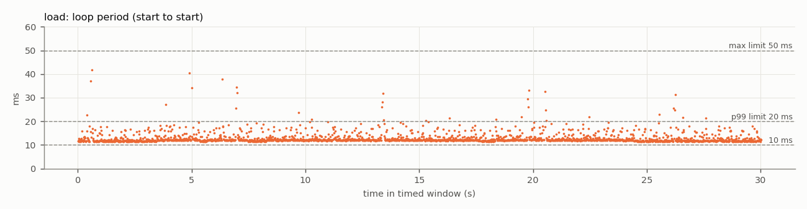
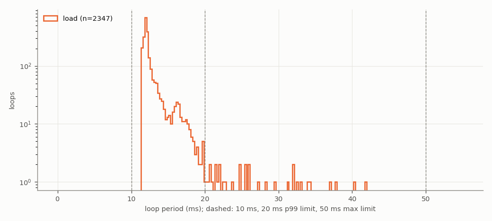
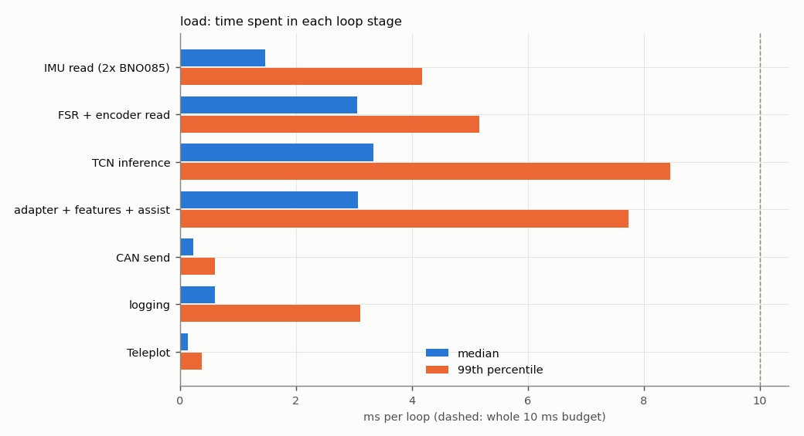
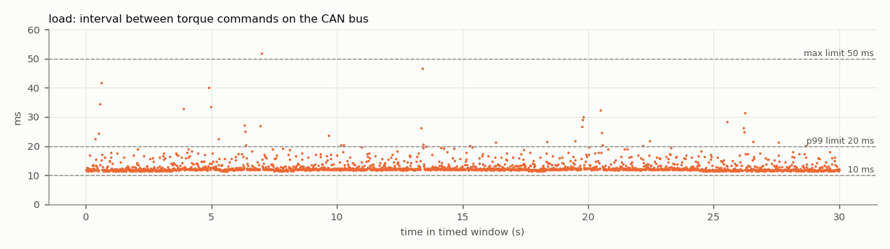

# Test 4 — Control loop and CAN command rate

**Verdict (load run): FAIL**

- Run: `fall_test_plan/test_4/results/20261027_174549_load`
- **SIMULATED SENSORS**: no sensors attached; sensor reads are placeholder waits ({'imu_both': 1.4, 'fsr_enc': 3.0} ms). CAN bus, motor, TCN, safety checks and logging are real. Re-run with the sensors connected for the final result.
- Controller: TCN `/home/axilles/exo_ws/ML_model/runs/deploy`, backend `onnx`; torque mode `computed`; scheduler `relative`; gait injection on
- Jetson: NVIDIA Jetson Orin Nano Engineering Reference Developer Kit Super; NV Power Mode: 25W; governor ['schedutil']; git 48144390 (axilles-154-Test4-Control-Loop-CAN-Command-rate)

| Criterion | Measured | Limit | Result |
|---|---|---|---|
| Mean loop rate | 78.2296 Hz | >= 100 Hz | **FAIL** |
| 99th-percentile period | 21.94 ms | <= 20 ms | **FAIL** |
| Largest period | 41.72 ms | <= 50 ms | **PASS** |
| CAN torque-command rate (on wire) | 78.2277 Hz | >= 100 Hz | **FAIL** |
| No controller restart | completed | single run, completed | **PASS** |
| No log or frame loss | none | none | **PASS** |
| No out-of-memory event | none | none | **PASS** |


**Diagnosis**

- The loop work alone takes 12.03 ms (median) of the 10 ms budget. Largest stages (median): TCN inference 3.33 ms, adapter + features + assist 3.07 ms, FSR + encoder read 3.06 ms, IMU read (2x BNO085) 1.47 ms.
- Largest single-stage spikes: FSR + encoder read 26.0 ms (p99 5.2), IMU read (2x BNO085) 24.4 ms (p99 4.2), TCN inference 23.9 ms (p99 8.5).

## Script output

| Metric | load |
|---|---|
| Timed loops | 2347 |
| Window (s) | 30.0 |
| Mean loop rate (Hz) | 78.2296 |
| Median period (ms) | 12.036 |
| 99th-pct period (ms) | 21.941 |
| Largest period (ms) | 41.716 |
| Periods > 10 ms (%) | 100.000 |
| Periods > 20 ms (%) | 1.406 |
| Loop work > 10 ms (%) | 100.000 |
| Loop work > 20 ms (%) | 1.406 |
| Periods > 50 ms | 0 |
| Loop work p50 / p99 (ms) | 12.03 / 21.92 |
| CAN cmd rate, wire (Hz) | 78.23 |
| CAN cmd rate, in-process (Hz) | 78.23 |
| CAN cmd interval p99 / max (ms) | 22.12 / 51.87 |
| Motor reply rate (Hz) | 49.96 |
| Bus error frames | 0 |
| Watchdog trips | 8 |
| RSS start / max (MB) | 541 / 703 |
| Min MemAvailable (MB) | 3589 |
| Max CPU temp (°C) | 49.0 |
| CPU freq min / max (MHz) | 730 / 1344 |

## Where the loop time goes (load run, ms)

| Stage | mean | p50 | p99 | max |
|---|---|---|---|---|
| IMU read (2x BNO085) | 1.559 | 1.471 | 4.175 | 24.383 |
| FSR + encoder read | 3.130 | 3.060 | 5.157 | 26.022 |
| TCN inference | 3.634 | 3.329 | 8.453 | 23.881 |
| adapter + features + assist | 3.339 | 3.067 | 7.741 | 23.055 |
| CAN send | 0.246 | 0.226 | 0.601 | 17.207 |
| logging | 0.673 | 0.602 | 3.105 | 21.665 |
| Teleplot | 0.162 | 0.138 | 0.373 | 6.445 |

Five longest periods (load run):

| t (s) | period | loop work | step | TCN | IMU | FSR+enc | send |
|---|---|---|---|---|---|---|---|
| 0.6 | 41.72 | 41.71 | 13.31 | 3.45 | 24.38 | 3.11 | 0.28 |
| 4.9 | 40.43 | 40.42 | 11.24 | 5.80 | 1.58 | 26.02 | 0.34 |
| 6.3 | 37.86 | 37.84 | 21.66 | 18.62 | 1.47 | 3.07 | 0.30 |
| 0.5 | 37.09 | 37.08 | 6.79 | 3.45 | 1.50 | 9.03 | 0.23 |
| 6.9 | 34.33 | 34.32 | 7.42 | 3.77 | 1.47 | 3.23 | 0.27 |

## CAN detail (load run)

```
{
  "inproc": {
    "cmd_frames_total": 2810,
    "cmd_frames_timed": 2347,
    "loops_without_exactly_one_cmd": 0,
    "send_errors": 0,
    "rate_hz": 78.2277041144764,
    "interval_ms": {
      "n": 2346,
      "mean": 12.78319504988445,
      "p50": 12.037225009407848,
      "p99": 22.082668612711238,
      "max": 51.85702000744641
    }
  },
  "monitor_recv_errors": 0,
  "monitor_last_error": "",
  "wire": {
    "cmd_frames_total": 2810,
    "error_frames": 0,
    "accounting_ok": true,
    "wall_clock_drift_ms": -0.0073909759521484375,
    "window_select": "index (exact)",
    "send_to_wire_ms": {
      "n": 2347,
      "mean": 0.14473948013442192,
      "p50": 0.15473365783691406,
      "p99": 0.18930435180664062,
      "max": 0.3476142883300781
    },
    "cmd_frames_timed": 2347,
    "rate_hz": 78.22768793352292,
    "interval_ms": {
      "n": 2346,
      "mean": 12.783197694015827,
      "p50": 12.034416198730469,
      "p99": 22.124469280243027,
      "max": 51.87273025512695
    },
    "_intervals": "<2346 values>",
    "_t": "<2346 values>",
    "rx_frames_timed": 1499,
    "rx_rate_hz": 49.96425043373196,
    "rx_ids": {
      "0x2968": 2078
    }
  },
  "link_delta": {
    "tx_packets": 2810,
    "tx_errors": 0,
    "tx_dropped": 0,
    "rx_packets": 2063,
    "rx_errors": 0,
    "rx_dropped": 0,
    "rx_over_errors": 0,
    "bus_error": 0,
    "error_warning": 0,
    "error_passive": 0,
    "bus_off": 0,
    "restarts": 0,
    "arbitration_lost": 0
  },
  "link_state_after": "ERROR-ACTIVE"
}
```

## Plots





