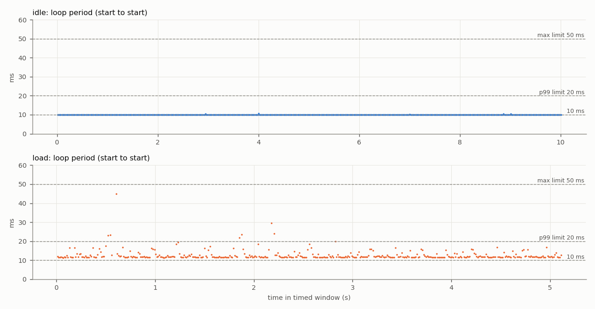
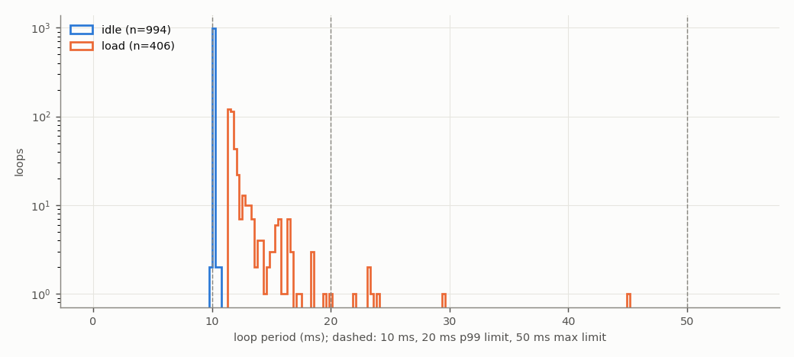
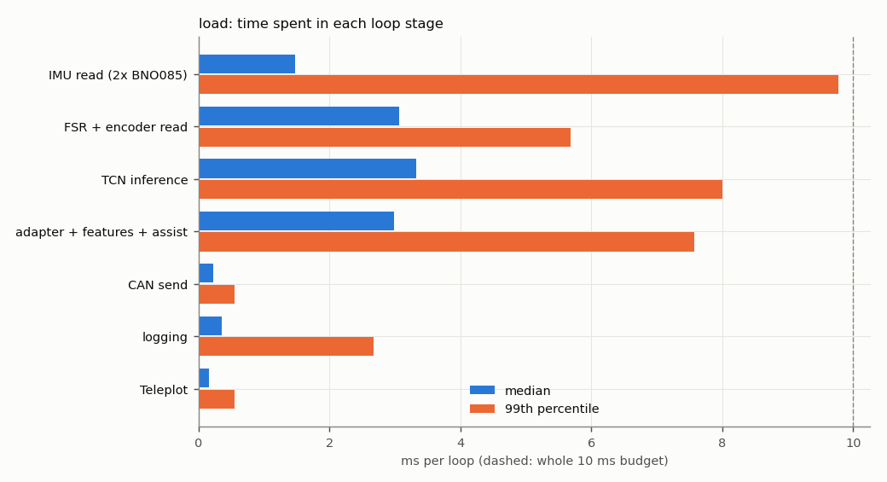
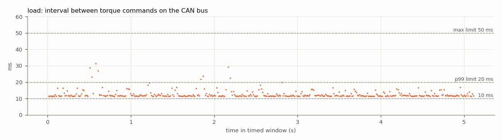

# Test 4 — Control loop and CAN command rate

**Verdict (load run): FAIL**

- Run: `/home/axilles/exo_ws/fall_test_plan/test_4/results/20261027_180325/load`
- **SIMULATED SENSORS**: no sensors attached; sensor reads are placeholder waits ({'imu_both': 1.4, 'fsr_enc': 3.0} ms). CAN bus, motor, TCN, safety checks and logging are real. Re-run with the sensors connected for the final result.
- Controller: TCN `/home/axilles/exo_ws/ML_model/runs/deploy`, backend `onnx`; torque mode `computed`; scheduler `relative`; gait injection on
- Jetson: NVIDIA Jetson Orin Nano Engineering Reference Developer Kit Super; NV Power Mode: 25W; governor ['schedutil']; git 48144390 (axilles-154-Test4-Control-Loop-CAN-Command-rate)

| Criterion | Measured | Limit | Result |
|---|---|---|---|
| Mean loop rate | 79.4494 Hz | >= 100 Hz | **FAIL** |
| 99th-percentile period | 23.30 ms | <= 20 ms | **FAIL** |
| Largest period | 45.01 ms | <= 50 ms | **PASS** |
| CAN torque-command rate (on wire) | 79.4527 Hz | >= 100 Hz | **FAIL** |
| No controller restart | interrupted | single run, completed | **FAIL** |
| No log or frame loss | none | none | **PASS** |
| No out-of-memory event | none | none | **PASS** |


**Diagnosis**

- The loop work alone takes 11.71 ms (median) of the 10 ms budget. Largest stages (median): TCN inference 3.32 ms, FSR + encoder read 3.06 ms, adapter + features + assist 2.99 ms, IMU read (2x BNO085) 1.48 ms.
- Largest single-stage spikes: IMU read (2x BNO085) 20.1 ms (p99 9.8), TCN inference 17.0 ms (p99 8.0), logging 14.1 ms (p99 2.7).

## Script output

| Metric | idle | load |
|---|---|---|
| Timed loops | 994 | 407 |
| Window (s) | 10.0 | 5.1 |
| Mean loop rate (Hz) | 99.3116 | 79.4494 |
| Median period (ms) | 10.064 | 11.713 |
| 99th-pct period (ms) | 10.094 | 23.303 |
| Largest period (ms) | 10.681 | 45.010 |
| Periods > 10 ms (%) | 100.000 | 100.000 |
| Periods > 20 ms (%) | 0.000 | 1.724 |
| Loop work > 10 ms (%) | 0.000 | 100.000 |
| Loop work > 20 ms (%) | 0.000 | 1.720 |
| Periods > 50 ms | 0 | 0 |
| Loop work p50 / p99 (ms) | 0.00 / 0.03 | 11.71 / 23.29 |
| CAN cmd rate, wire (Hz) | — | 79.45 |
| CAN cmd rate, in-process (Hz) | — | 79.45 |
| CAN cmd interval p99 / max (ms) | — | 23.58 / 31.33 |
| Motor reply rate (Hz) | — | 50.10 |
| Bus error frames | — | 0 |
| Watchdog trips | 0 | 2 |
| RSS start / max (MB) | 516 / 517 | 517 / 683 |
| Min MemAvailable (MB) | 3394 | 3284 |
| Max CPU temp (°C) | 45.2 | 46.6 |
| CPU freq min / max (MHz) | 730 / 1344 | 730 / 1344 |

## Where the loop time goes (load run, ms)

| Stage | mean | p50 | p99 | max |
|---|---|---|---|---|
| IMU read (2x BNO085) | 1.656 | 1.476 | 9.774 | 20.075 |
| FSR + encoder read | 3.184 | 3.061 | 5.687 | 7.624 |
| TCN inference | 3.573 | 3.322 | 8.005 | 16.978 |
| adapter + features + assist | 3.241 | 2.990 | 7.570 | 8.688 |
| CAN send | 0.234 | 0.223 | 0.547 | 1.039 |
| logging | 0.477 | 0.349 | 2.668 | 14.146 |
| Teleplot | 0.173 | 0.153 | 0.549 | 4.281 |

Five longest periods (load run):

| t (s) | period | loop work | step | TCN | IMU | FSR+enc | send |
|---|---|---|---|---|---|---|---|
| 0.6 | 45.01 | 45.00 | 7.23 | 3.79 | 20.07 | 3.14 | 0.21 |
| 2.2 | 29.48 | 29.47 | 21.23 | 16.98 | 1.93 | 5.28 | 0.31 |
| 2.2 | 23.94 | 23.93 | 8.23 | 3.78 | 10.05 | 3.07 | 0.31 |
| 1.9 | 23.60 | 23.58 | 6.76 | 3.35 | 12.96 | 3.07 | 0.24 |
| 0.5 | 23.31 | 23.30 | 7.04 | 3.58 | 11.93 | 3.14 | 0.30 |

## CAN detail (load run)

```
{
  "inproc": {
    "cmd_frames_total": 871,
    "cmd_frames_timed": 407,
    "loops_without_exactly_one_cmd": 0,
    "send_errors": 0,
    "rate_hz": 79.45334734940232,
    "interval_ms": {
      "n": 406,
      "mean": 12.58600214289804,
      "p50": 11.719824484316632,
      "p99": 23.55128837516531,
      "max": 31.37728397268802
    }
  },
  "monitor_recv_errors": 0,
  "monitor_last_error": "",
  "wire": {
    "cmd_frames_total": 871,
    "error_frames": 0,
    "accounting_ok": true,
    "wall_clock_drift_ms": -0.0059604644775390625,
    "window_select": "index (exact)",
    "send_to_wire_ms": {
      "n": 407,
      "mean": 0.1533300929338985,
      "p50": 0.15306472778320312,
      "p99": 0.1662158966064453,
      "max": 0.19931793212890625
    },
    "cmd_frames_timed": 407,
    "rate_hz": 79.45266067365193,
    "interval_ms": {
      "n": 406,
      "mean": 12.58611091839269,
      "p50": 11.717438697814941,
      "p99": 23.57857227325439,
      "max": 31.329870223999023
    },
    "_intervals": "<406 values>",
    "_t": "<406 values>",
    "rx_frames_timed": 256,
    "rx_rate_hz": 50.09614445939189,
    "rx_ids": {
      "0x2968": 835
    }
  },
  "link_delta": {
    "tx_packets": 871,
    "tx_errors": 0,
    "tx_dropped": 0,
    "rx_packets": 822,
    "rx_errors": 0,
    "rx_dropped": 0,
    "rx_over_errors": 0,
    "bus_error": 0,
    "error_warning": 0,
    "error_passive": 0,
    "bus_off": 0,
    "restarts": 0,
    "arbitration_lost": 0
  },
  "link_state_after": "ERROR-ACTIVE"
}
```

## Plots





