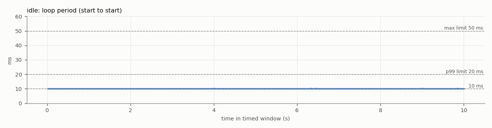
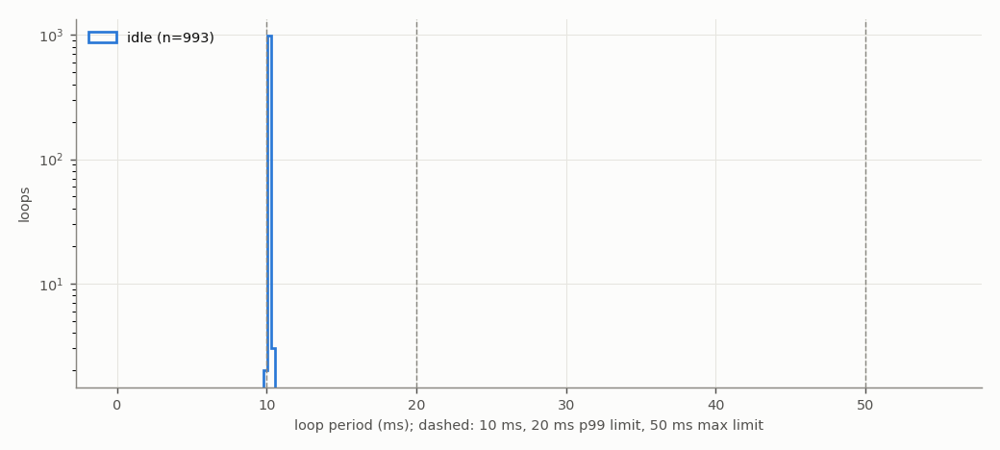

# Test 4 — Control loop and CAN command rate

**Verdict (load run): FAIL**

- Run: `/home/axilles/exo_ws/fall_test_plan/test_4/results/20261027_181615/load`
- **SIMULATED SENSORS**: no sensors attached; sensor reads are placeholder waits ({'imu_both': 1.4, 'fsr_enc': 3.0} ms). CAN bus, motor, TCN, safety checks and logging are real. Re-run with the sensors connected for the final result.
- Controller: TCN `/home/axilles/exo_ws/ML_model/runs/deploy`, backend `onnx`; torque mode `computed`; scheduler `relative`; gait injection on
- Jetson: NVIDIA Jetson Orin Nano Engineering Reference Developer Kit Super; NV Power Mode: 25W; governor ['schedutil']; git 48144390 (axilles-154-Test4-Control-Loop-CAN-Command-rate)

| Criterion | Measured | Limit | Result |
|---|---|---|---|
| Mean loop rate | nan Hz | >= 100 Hz | **FAIL** |
| 99th-percentile period | nan ms | <= 20 ms | **FAIL** |
| Largest period | nan ms | <= 50 ms | **FAIL** |
| CAN torque-command rate | no data | >= 100 Hz | **FAIL** |
| No controller restart | interrupted | single run, completed | **FAIL** |
| No log or frame loss | none | none | **PASS** |
| No out-of-memory event | none | none | **PASS** |


## Script output

| Metric | idle | load |
|---|---|---|
| Timed loops | 993 | 0 |
| Window (s) | 10.0 | — |
| Mean loop rate (Hz) | 99.2857 | — |
| Median period (ms) | 10.070 | — |
| 99th-pct period (ms) | 10.115 | — |
| Largest period (ms) | 10.387 | — |
| Periods > 10 ms (%) | 100.000 | — |
| Periods > 20 ms (%) | 0.000 | — |
| Loop work > 10 ms (%) | 0.000 | — |
| Loop work > 20 ms (%) | 0.000 | — |
| Periods > 50 ms | 0 | — |
| Loop work p50 / p99 (ms) | 0.01 / 0.04 | — |
| CAN cmd rate, wire (Hz) | — | — |
| CAN cmd rate, in-process (Hz) | — | — |
| CAN cmd interval p99 / max (ms) | — | — |
| Motor reply rate (Hz) | — | — |
| Bus error frames | — | — |
| Watchdog trips | 0 | — |
| RSS start / max (MB) | 512 / 514 | 514 / 670 |
| Min MemAvailable (MB) | 2558 | 2440 |
| Max CPU temp (°C) | 46.4 | 47.2 |
| CPU freq min / max (MHz) | 730 / 1344 | 806 / 1344 |

## CAN detail (load run)

```
{}
```

## Plots



