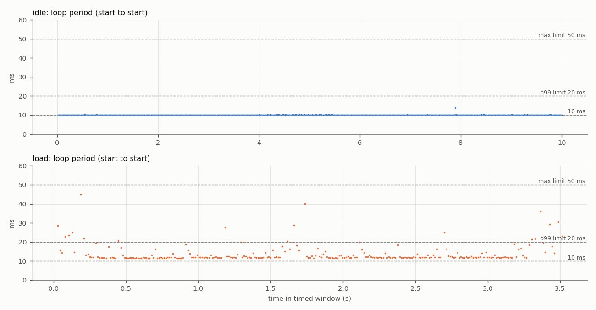
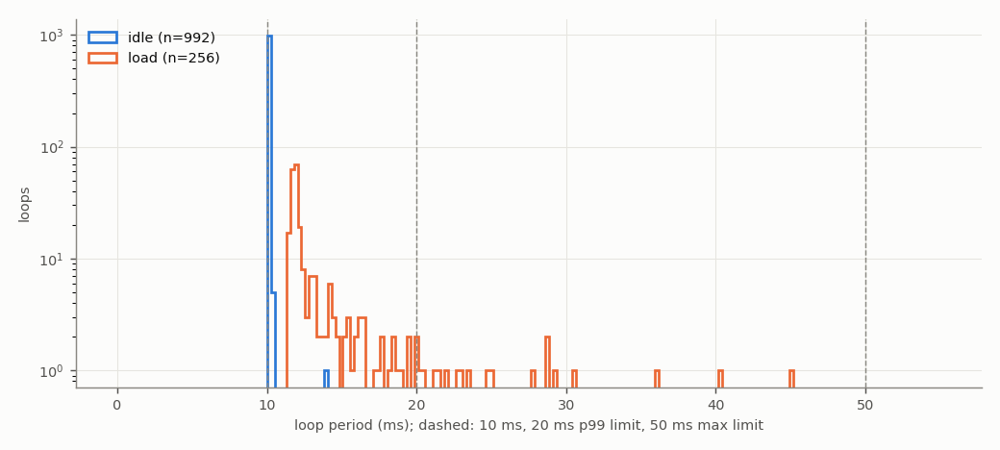
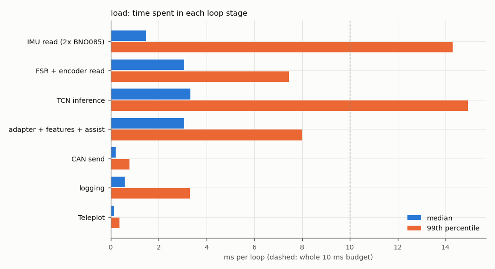
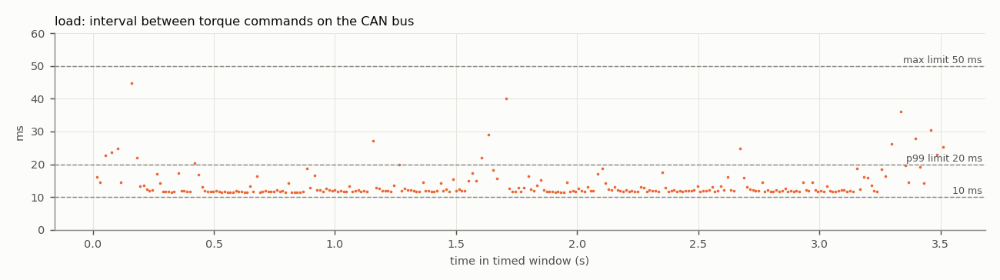

# Test 4 — Control loop and CAN command rate

**Verdict (load run): FAIL**

- Run: `/home/axilles/exo_ws/fall_test_plan/test_4/results/20261027_181707/load`
- **SIMULATED SENSORS**: no sensors attached; sensor reads are placeholder waits ({'imu_both': 1.4, 'fsr_enc': 3.0} ms). CAN bus, motor, TCN, safety checks and logging are real. Re-run with the sensors connected for the final result.
- Controller: TCN `/home/axilles/exo_ws/ML_model/runs/deploy`, backend `onnx`; torque mode `computed`; scheduler `relative`; gait injection on
- Jetson: NVIDIA Jetson Orin Nano Engineering Reference Developer Kit Super; NV Power Mode: 25W; governor ['schedutil']; git 48144390 (axilles-154-Test4-Control-Loop-CAN-Command-rate)

| Criterion | Measured | Limit | Result |
|---|---|---|---|
| Mean loop rate | 72.8962 Hz | >= 100 Hz | **FAIL** |
| 99th-percentile period | 33.03 ms | <= 20 ms | **FAIL** |
| Largest period | 44.96 ms | <= 50 ms | **PASS** |
| CAN torque-command rate (on wire) | 72.9523 Hz | >= 100 Hz | **FAIL** |
| No controller restart | interrupted | single run, completed | **FAIL** |
| No log or frame loss | none | none | **PASS** |
| No out-of-memory event | none | none | **PASS** |


**Diagnosis**

- The loop work alone takes 11.95 ms (median) of the 10 ms budget. Largest stages (median): TCN inference 3.33 ms, adapter + features + assist 3.06 ms, FSR + encoder read 3.06 ms, IMU read (2x BNO085) 1.47 ms.
- Largest single-stage spikes: IMU read (2x BNO085) 28.9 ms (p99 14.3), TCN inference 23.7 ms (p99 14.9), FSR + encoder read 16.6 ms (p99 7.4).

## Script output

| Metric | idle | load |
|---|---|---|
| Timed loops | 992 | 257 |
| Window (s) | 10.0 | 3.5 |
| Mean loop rate (Hz) | 99.1720 | 72.8962 |
| Median period (ms) | 10.075 | 11.959 |
| 99th-pct period (ms) | 10.282 | 33.025 |
| Largest period (ms) | 13.929 | 44.964 |
| Periods > 10 ms (%) | 100.000 | 100.000 |
| Periods > 20 ms (%) | 0.000 | 7.031 |
| Loop work > 10 ms (%) | 0.000 | 100.000 |
| Loop work > 20 ms (%) | 0.000 | 7.393 |
| Periods > 50 ms | 0 | 0 |
| Loop work p50 / p99 (ms) | 0.01 / 0.05 | 11.95 / 32.95 |
| CAN cmd rate, wire (Hz) | — | 72.95 |
| CAN cmd rate, in-process (Hz) | — | 72.95 |
| CAN cmd interval p99 / max (ms) | — | 33.00 / 44.80 |
| Motor reply rate (Hz) | — | 50.12 |
| Bus error frames | — | 0 |
| Watchdog trips | 0 | 8 |
| RSS start / max (MB) | 504 / 506 | 513 / 670 |
| Min MemAvailable (MB) | 2572 | 2636 |
| Max CPU temp (°C) | 47.7 | 48.3 |
| CPU freq min / max (MHz) | 730 / 1344 | 730 / 1344 |

## Where the loop time goes (load run, ms)

| Stage | mean | p50 | p99 | max |
|---|---|---|---|---|
| IMU read (2x BNO085) | 2.112 | 1.473 | 14.299 | 28.862 |
| FSR + encoder read | 3.276 | 3.062 | 7.440 | 16.588 |
| TCN inference | 3.836 | 3.329 | 14.933 | 23.669 |
| adapter + features + assist | 3.421 | 3.063 | 7.991 | 12.290 |
| CAN send | 0.246 | 0.212 | 0.786 | 3.804 |
| logging | 0.650 | 0.571 | 3.299 | 5.235 |
| Teleplot | 0.166 | 0.142 | 0.367 | 4.251 |

Five longest periods (load run):

| t (s) | period | loop work | step | TCN | IMU | FSR+enc | send |
|---|---|---|---|---|---|---|---|
| 0.1 | 44.96 | 44.95 | 28.42 | 23.67 | 12.25 | 3.07 | 0.30 |
| 1.7 | 40.23 | 40.22 | 7.40 | 3.74 | 28.86 | 3.07 | 0.26 |
| 3.3 | 36.15 | 36.13 | 18.50 | 12.96 | 13.45 | 3.06 | 0.33 |
| 3.5 | 30.47 | 30.46 | 8.39 | 4.09 | 18.02 | 3.08 | 0.25 |
| 3.4 | 29.26 | 29.24 | 21.49 | 17.72 | 2.00 | 3.07 | 0.32 |

## CAN detail (load run)

```
{
  "inproc": {
    "cmd_frames_total": 644,
    "cmd_frames_timed": 257,
    "loops_without_exactly_one_cmd": 0,
    "send_errors": 0,
    "rate_hz": 72.95207880596149,
    "interval_ms": {
      "n": 256,
      "mean": 13.707628574366026,
      "p50": 11.966613004915416,
      "p99": 33.021354666561756,
      "max": 44.82723702676594
    }
  },
  "monitor_recv_errors": 0,
  "monitor_last_error": "",
  "wire": {
    "cmd_frames_total": 644,
    "error_frames": 0,
    "accounting_ok": true,
    "wall_clock_drift_ms": -0.003814697265625,
    "window_select": "index (exact)",
    "send_to_wire_ms": {
      "n": 257,
      "mean": 0.15549344311428442,
      "p50": 0.15473365783691406,
      "p99": 0.17730712890625,
      "max": 0.2551078796386719
    },
    "cmd_frames_timed": 257,
    "rate_hz": 72.95233708115867,
    "interval_ms": {
      "n": 256,
      "mean": 13.707580044865608,
      "p50": 11.966943740844727,
      "p99": 32.99772739410394,
      "max": 44.79646682739258
    },
    "_intervals": "<256 values>",
    "_t": "<256 values>",
    "rx_frames_timed": 176,
    "rx_rate_hz": 50.116159902455784,
    "rx_ids": {
      "0x2968": 770
    }
  },
  "link_delta": {
    "tx_packets": 644,
    "tx_errors": 0,
    "tx_dropped": 0,
    "rx_packets": 756,
    "rx_errors": 0,
    "rx_dropped": 0,
    "rx_over_errors": 0,
    "bus_error": 0,
    "error_warning": 0,
    "error_passive": 0,
    "bus_off": 0,
    "restarts": 0,
    "arbitration_lost": 0
  },
  "link_state_after": "ERROR-ACTIVE"
}
```

## Plots





