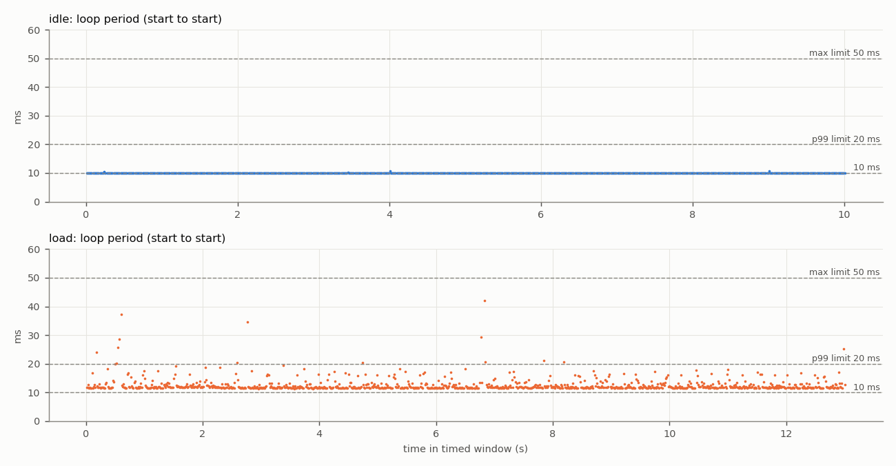
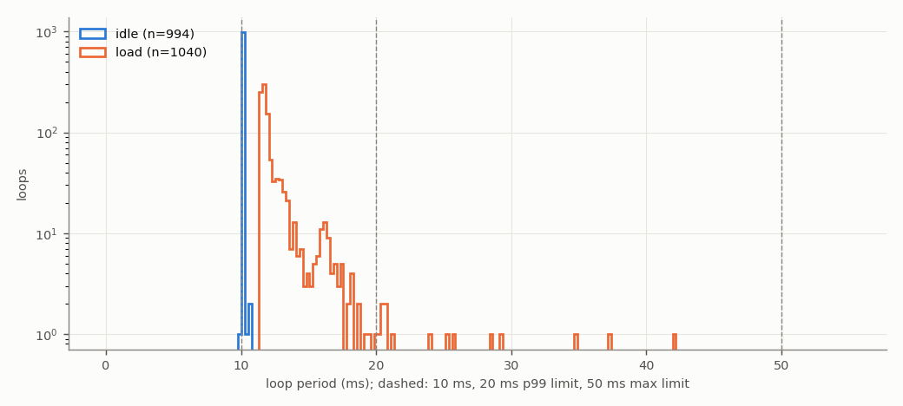
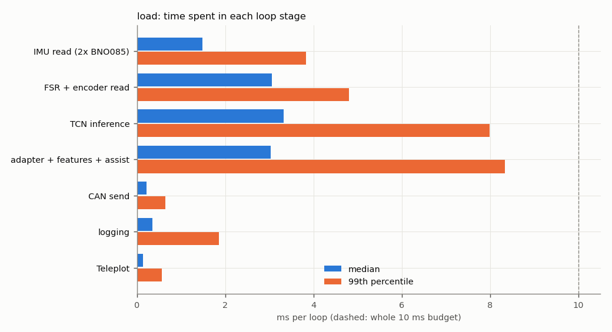
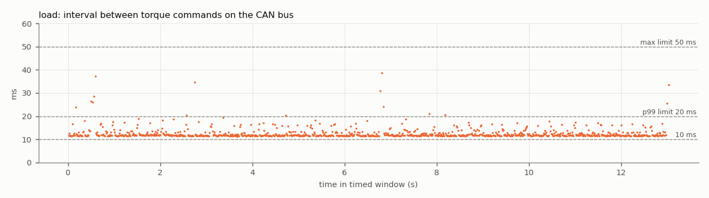

# Test 4 — Control loop and CAN command rate

**Verdict (load run): FAIL**

- Run: `/home/axilles/exo_ws/fall_test_plan/test_4/results/20261027_182700/load`
- **SIMULATED SENSORS**: no sensors attached; sensor reads are placeholder waits ({'imu_both': 1.4, 'fsr_enc': 3.0} ms). CAN bus, motor, TCN, safety checks and logging are real. Re-run with the sensors connected for the final result.
- Controller: TCN `/home/axilles/exo_ws/ML_model/runs/deploy`, backend `onnx`; torque mode `computed`; scheduler `relative`; gait injection on
- Jetson: NVIDIA Jetson Orin Nano Engineering Reference Developer Kit Super; NV Power Mode: 25W; governor ['schedutil']; git 48144390 (axilles-154-Test4-Control-Loop-CAN-Command-rate)

| Criterion | Measured | Limit | Result |
|---|---|---|---|
| Mean loop rate | 79.9743 Hz | >= 100 Hz | **FAIL** |
| 99th-percentile period | 20.54 ms | <= 20 ms | **FAIL** |
| Largest period | 42.15 ms | <= 50 ms | **PASS** |
| CAN torque-command rate (on wire) | 79.8403 Hz | >= 100 Hz | **FAIL** |
| No controller restart | interrupted | single run, completed | **FAIL** |
| No log or frame loss | none | none | **PASS** |
| No out-of-memory event | none | none | **PASS** |


**Diagnosis**

- The loop work alone takes 11.76 ms (median) of the 10 ms budget. Largest stages (median): TCN inference 3.32 ms, FSR + encoder read 3.06 ms, adapter + features + assist 3.03 ms, IMU read (2x BNO085) 1.48 ms.
- Largest single-stage spikes: IMU read (2x BNO085) 23.0 ms (p99 3.8), logging 18.2 ms (p99 1.8), TCN inference 17.9 ms (p99 8.0).

## Script output

| Metric | idle | load |
|---|---|---|
| Timed loops | 994 | 1041 |
| Window (s) | 10.0 | 13.0 |
| Mean loop rate (Hz) | 99.3111 | 79.9743 |
| Median period (ms) | 10.063 | 11.766 |
| 99th-pct period (ms) | 10.090 | 20.545 |
| Largest period (ms) | 10.740 | 42.152 |
| Periods > 10 ms (%) | 100.000 | 100.000 |
| Periods > 20 ms (%) | 0.000 | 1.346 |
| Loop work > 10 ms (%) | 0.000 | 100.000 |
| Loop work > 20 ms (%) | 0.000 | 1.441 |
| Periods > 50 ms | 0 | 0 |
| Loop work p50 / p99 (ms) | 0.01 / 0.03 | 11.76 / 20.68 |
| CAN cmd rate, wire (Hz) | — | 79.84 |
| CAN cmd rate, in-process (Hz) | — | 79.84 |
| CAN cmd interval p99 / max (ms) | — | 22.72 / 38.80 |
| Motor reply rate (Hz) | — | 49.98 |
| Bus error frames | — | 0 |
| Watchdog trips | 0 | 5 |
| RSS start / max (MB) | 511 / 513 | 511 / 667 |
| Min MemAvailable (MB) | 3237 | 3135 |
| Max CPU temp (°C) | 45.6 | 47.5 |
| CPU freq min / max (MHz) | 730 / 1344 | 730 / 1344 |

## Where the loop time goes (load run, ms)

| Stage | mean | p50 | p99 | max |
|---|---|---|---|---|
| IMU read (2x BNO085) | 1.586 | 1.475 | 3.829 | 23.001 |
| FSR + encoder read | 3.116 | 3.060 | 4.799 | 13.965 |
| TCN inference | 3.621 | 3.317 | 7.990 | 17.939 |
| adapter + features + assist | 3.305 | 3.028 | 8.339 | 12.751 |
| CAN send | 0.238 | 0.222 | 0.645 | 5.050 |
| logging | 0.463 | 0.350 | 1.849 | 18.196 |
| Teleplot | 0.157 | 0.137 | 0.558 | 4.525 |

Five longest periods (load run):

| t (s) | period | loop work | step | TCN | IMU | FSR+enc | send |
|---|---|---|---|---|---|---|---|
| 6.8 | 42.15 | 42.13 | 11.31 | 6.36 | 23.00 | 3.06 | 0.66 |
| 0.6 | 37.32 | 37.30 | 21.83 | 17.94 | 11.55 | 3.06 | 0.24 |
| 2.7 | 34.68 | 34.67 | 18.46 | 15.34 | 1.47 | 13.96 | 0.24 |
| 6.7 | 29.28 | 29.26 | 6.14 | 3.25 | 1.47 | 3.06 | 0.22 |
| 0.5 | 28.61 | 28.59 | 16.43 | 12.29 | 8.18 | 3.06 | 0.23 |

## CAN detail (load run)

```
{
  "inproc": {
    "cmd_frames_total": 1508,
    "cmd_frames_timed": 1041,
    "loops_without_exactly_one_cmd": 0,
    "send_errors": 0,
    "rate_hz": 79.84036320428015,
    "interval_ms": {
      "n": 1040,
      "mean": 12.524993122105325,
      "p50": 11.773448990425095,
      "p99": 22.72232767019859,
      "max": 38.79026003414765
    }
  },
  "monitor_recv_errors": 0,
  "monitor_last_error": "",
  "wire": {
    "cmd_frames_total": 1508,
    "error_frames": 0,
    "accounting_ok": true,
    "wall_clock_drift_ms": -0.00667572021484375,
    "window_select": "index (exact)",
    "send_to_wire_ms": {
      "n": 1041,
      "mean": 0.148040531462597,
      "p50": 0.15306472778320312,
      "p99": 0.17638206481933577,
      "max": 0.28014183044433594
    },
    "cmd_frames_timed": 1041,
    "rate_hz": 79.84033529573253,
    "interval_ms": {
      "n": 1040,
      "mean": 12.524997500272898,
      "p50": 11.761665344238281,
      "p99": 22.723987102508268,
      "max": 38.79976272583008
    },
    "_intervals": "<1040 values>",
    "_t": "<1040 values>",
    "rx_frames_timed": 650,
    "rx_rate_hz": 49.98391467331423,
    "rx_ids": {
      "0x2968": 1229
    }
  },
  "link_delta": {
    "tx_packets": 1508,
    "tx_errors": 0,
    "tx_dropped": 0,
    "rx_packets": 1214,
    "rx_errors": 0,
    "rx_dropped": 0,
    "rx_over_errors": 0,
    "bus_error": 0,
    "error_warning": 0,
    "error_passive": 0,
    "bus_off": 0,
    "restarts": 0,
    "arbitration_lost": 0
  },
  "link_state_after": "ERROR-ACTIVE"
}
```

## Plots





