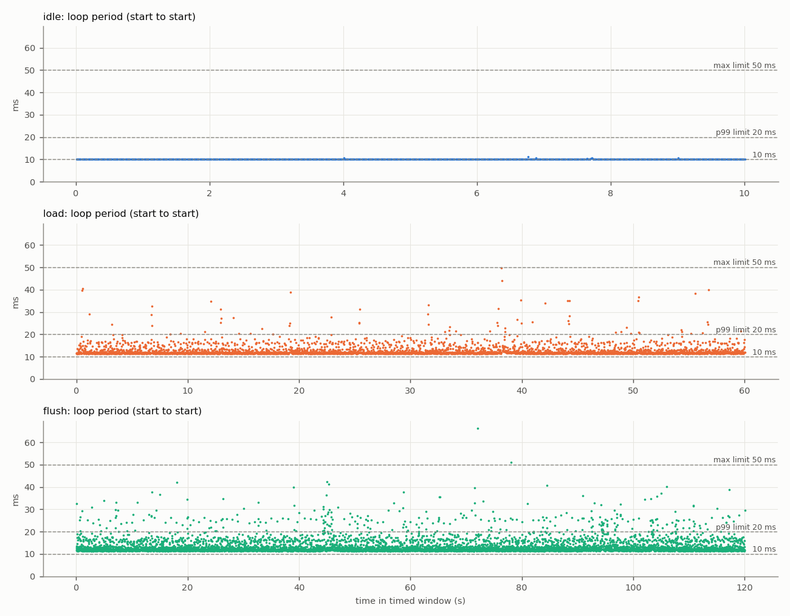
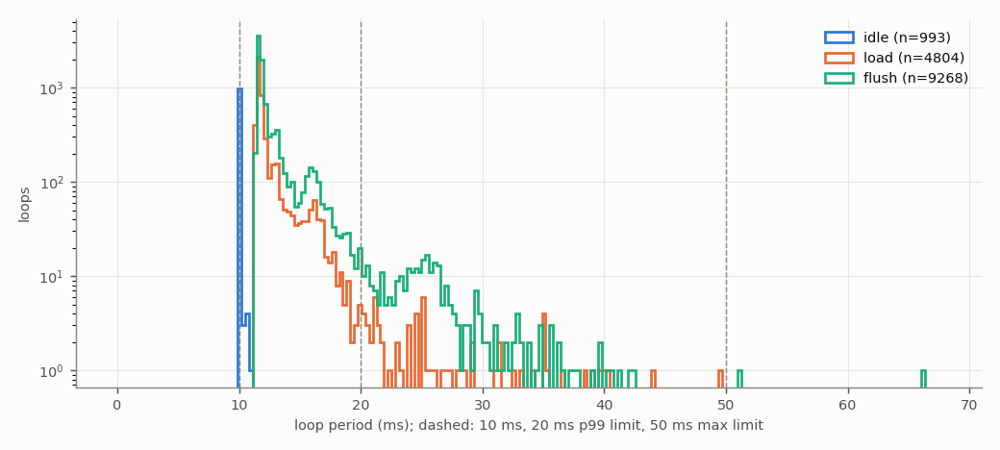
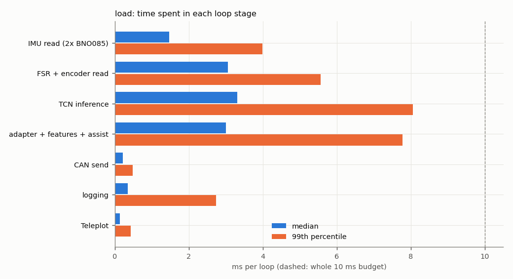
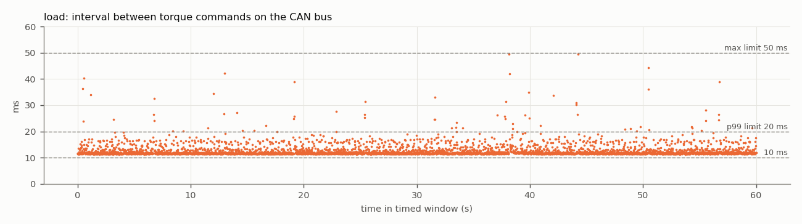

# Test 4 — Control loop and CAN command rate

**Verdict (load run): FAIL**

- Run: `/home/axilles/exo_ws/fall_test_plan/test_4/results/20261027_182806/load`
- **SIMULATED SENSORS**: no sensors attached; sensor reads are placeholder waits ({'imu_both': 1.4, 'fsr_enc': 3.0} ms). CAN bus, motor, TCN, safety checks and logging are real. Re-run with the sensors connected for the final result.
- Controller: TCN `/home/axilles/exo_ws/ML_model/runs/deploy`, backend `onnx`; torque mode `computed`; scheduler `relative`; gait injection on
- Jetson: NVIDIA Jetson Orin Nano Engineering Reference Developer Kit Super; NV Power Mode: 25W; governor ['schedutil']; git 48144390 (axilles-154-Test4-Control-Loop-CAN-Command-rate)

| Criterion | Measured | Limit | Result |
|---|---|---|---|
| Mean loop rate | 80.0627 Hz | >= 100 Hz | **FAIL** |
| 99th-percentile period | 21.75 ms | <= 20 ms | **FAIL** |
| Largest period | 49.68 ms | <= 50 ms | **PASS** |
| CAN torque-command rate (on wire) | 80.0618 Hz | >= 100 Hz | **FAIL** |
| No controller restart | completed | single run, completed | **PASS** |
| No log or frame loss | none | none | **PASS** |
| No out-of-memory event | none | none | **PASS** |


**Diagnosis**

- The loop work alone takes 11.69 ms (median) of the 10 ms budget. Largest stages (median): TCN inference 3.30 ms, FSR + encoder read 3.06 ms, adapter + features + assist 3.00 ms, IMU read (2x BNO085) 1.48 ms.
- Largest single-stage spikes: IMU read (2x BNO085) 28.5 ms (p99 4.0), TCN inference 26.9 ms (p99 8.1), adapter + features + assist 25.2 ms (p99 7.8).

## Script output

| Metric | idle | load | flush |
|---|---|---|---|
| Timed loops | 993 | 4804 | 9268 |
| Window (s) | 10.0 | 60.0 | 120.0 |
| Mean loop rate (Hz) | 99.2547 | 80.0627 | 77.2160 |
| Median period (ms) | 10.072 | 11.698 | 11.827 |
| 99th-pct period (ms) | 10.132 | 21.745 | 26.428 |
| Largest period (ms) | 11.054 | 49.683 | 66.270 |
| Periods > 10 ms (%) | 100.000 | 100.000 | 100.000 |
| Periods > 20 ms (%) | 0.000 | 1.415 | 3.323 |
| Loop work > 10 ms (%) | 0.000 | 100.000 | 100.000 |
| Loop work > 20 ms (%) | 0.000 | 1.415 | 3.323 |
| Periods > 50 ms | 0 | 0 | 2 |
| Loop work p50 / p99 (ms) | 0.01 / 0.03 | 11.69 / 21.74 | 11.82 / 26.41 |
| CAN cmd rate, wire (Hz) | — | 80.06 | 77.23 |
| CAN cmd rate, in-process (Hz) | — | 80.06 | 77.23 |
| CAN cmd interval p99 / max (ms) | — | 21.78 / 49.45 | 27.04 / 63.16 |
| Motor reply rate (Hz) | — | 49.98 | 49.99 |
| Bus error frames | — | 0 | 0 |
| Watchdog trips | 0 | 21 | 44 |
| RSS start / max (MB) | 511 / 513 | 511 / 668 | 514 / 674 |
| Min MemAvailable (MB) | 3248 | 3138 | 3124 |
| Max CPU temp (°C) | 46.4 | 49.3 | 50.5 |
| CPU freq min / max (MHz) | 730 / 1344 | 730 / 1344 | 730 / 1344 |

## Where the loop time goes (load run, ms)

| Stage | mean | p50 | p99 | max |
|---|---|---|---|---|
| IMU read (2x BNO085) | 1.578 | 1.475 | 3.984 | 28.499 |
| FSR + encoder read | 3.145 | 3.061 | 5.562 | 17.098 |
| TCN inference | 3.590 | 3.303 | 8.054 | 26.932 |
| adapter + features + assist | 3.260 | 3.003 | 7.771 | 25.181 |
| CAN send | 0.235 | 0.220 | 0.476 | 6.077 |
| logging | 0.483 | 0.344 | 2.738 | 23.388 |
| Teleplot | 0.158 | 0.142 | 0.425 | 5.747 |

Five longest periods (load run):

| t (s) | period | loop work | step | TCN | IMU | FSR+enc | send |
|---|---|---|---|---|---|---|---|
| 38.1 | 49.68 | 49.67 | 44.11 | 19.42 | 1.48 | 3.06 | 0.28 |
| 38.2 | 44.00 | 43.99 | 21.28 | 16.39 | 16.53 | 3.07 | 0.29 |
| 0.5 | 40.38 | 40.36 | 7.88 | 3.62 | 28.50 | 3.12 | 0.24 |
| 56.7 | 39.94 | 39.92 | 9.23 | 5.33 | 25.78 | 3.07 | 0.29 |
| 0.5 | 39.65 | 39.63 | 8.80 | 4.22 | 13.04 | 6.13 | 1.82 |

## Disk-flush run (marked)

In-loop write + fsync every 1.0 s: 121 loops did a flush, which cost p50 13.56 ms, max 49.71 ms. Largest period 66.27 ms vs 49.68 ms without flushing. Criteria on this run: Mean loop rate FAIL, 99th-percentile period FAIL, Largest period FAIL, CAN torque-command rate (on wire) FAIL, No controller restart PASS, No log or frame loss PASS, No out-of-memory event PASS.

## CAN detail (load run)

```
{
  "inproc": {
    "cmd_frames_total": 5272,
    "cmd_frames_timed": 4804,
    "loops_without_exactly_one_cmd": 0,
    "send_errors": 0,
    "rate_hz": 80.06176553014734,
    "interval_ms": {
      "n": 4803,
      "mean": 12.490356581300333,
      "p50": 11.704295000527054,
      "p99": 21.75830281223164,
      "max": 49.43068599095568
    }
  },
  "monitor_recv_errors": 0,
  "monitor_last_error": "",
  "wire": {
    "cmd_frames_total": 5272,
    "error_frames": 0,
    "accounting_ok": true,
    "wall_clock_drift_ms": -0.0045299530029296875,
    "window_select": "index (exact)",
    "send_to_wire_ms": {
      "n": 4804,
      "mean": 0.15482964067038252,
      "p50": 0.15544891357421875,
      "p99": 0.18835067749023438,
      "max": 0.3342628479003906
    },
    "cmd_frames_timed": 4804,
    "rate_hz": 80.06175897413573,
    "interval_ms": {
      "n": 4803,
      "mean": 12.490357604097282,
      "p50": 11.698246002197266,
      "p99": 21.776247024536065,
      "max": 49.45111274719238
    },
    "_intervals": "<4803 values>",
    "_t": "<4803 values>",
    "rx_frames_timed": 2999,
    "rx_rate_hz": 49.98085055902466,
    "rx_ids": {
      "0x2968": 3574
    }
  },
  "link_delta": {
    "tx_packets": 5272,
    "tx_errors": 0,
    "tx_dropped": 0,
    "rx_packets": 3560,
    "rx_errors": 0,
    "rx_dropped": 0,
    "rx_over_errors": 0,
    "bus_error": 0,
    "error_warning": 0,
    "error_passive": 0,
    "bus_off": 0,
    "restarts": 0,
    "arbitration_lost": 0
  },
  "link_state_after": "ERROR-ACTIVE"
}
```

## Plots





