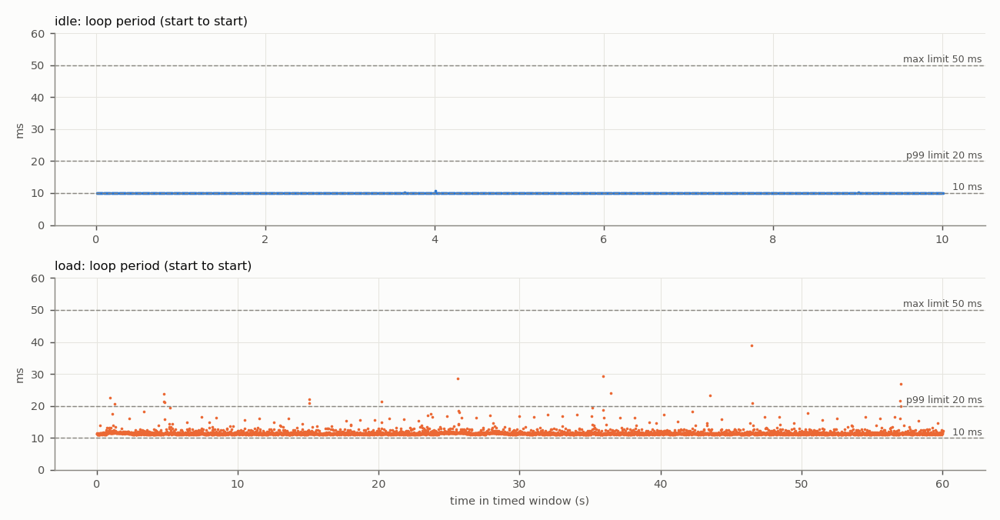
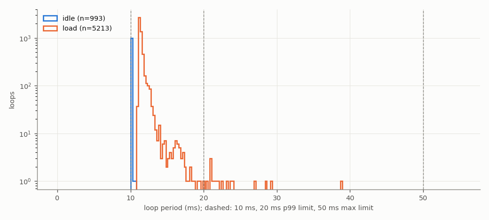
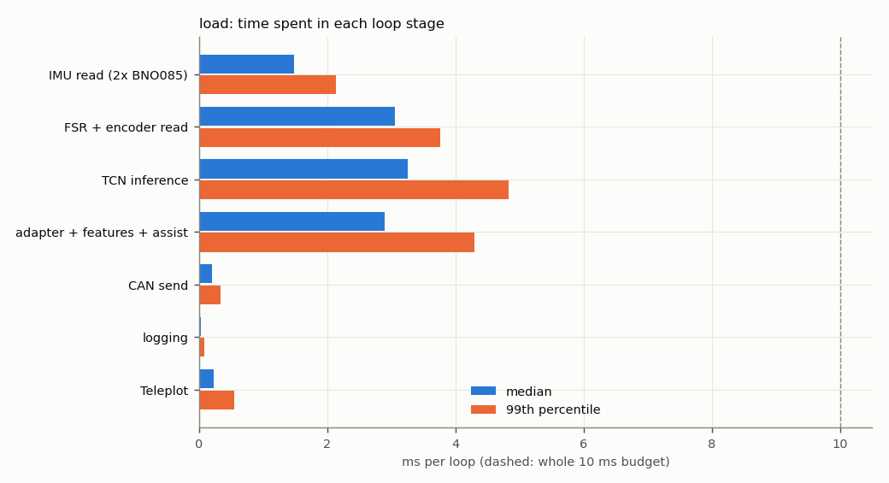
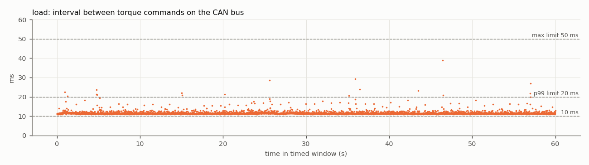

# Test 4 — Control loop and CAN command rate

**Verdict (load run): FAIL**

- Run: `/home/axilles/exo_ws/fall_test_plan/test_4/results/20261027_192507/load`
- **SIMULATED SENSORS**: no sensors attached; sensor reads are placeholder waits ({'imu_both': 1.4, 'fsr_enc': 3.0} ms). CAN bus, motor, TCN, safety checks and logging are real. Re-run with the sensors connected for the final result.
- Controller: TCN `/home/axilles/exo_ws/ML_model/runs/deploy`, backend `onnx`; torque mode `zero`; scheduler `relative`; gait injection on
- Jetson: NVIDIA Jetson Orin Nano Engineering Reference Developer Kit Super; NV Power Mode: 25W; governor ['schedutil']; git 48144390 (axilles-154-Test4-Control-Loop-CAN-Command-rate)

| Criterion | Measured | Limit | Result |
|---|---|---|---|
| Mean loop rate | 86.8676 Hz | >= 100 Hz | **FAIL** |
| 99th-percentile period | 16.07 ms | <= 20 ms | **PASS** |
| Largest period | 38.92 ms | <= 50 ms | **PASS** |
| CAN torque-command rate (on wire) | 86.8672 Hz | >= 100 Hz | **FAIL** |
| No controller restart | completed | single run, completed | **PASS** |
| No log or frame loss | none | none | **PASS** |
| No out-of-memory event | none | none | **PASS** |


**Diagnosis**

- The loop work alone takes 11.28 ms (median) of the 10 ms budget. Largest stages (median): TCN inference 3.26 ms, FSR + encoder read 3.06 ms, adapter + features + assist 2.90 ms, IMU read (2x BNO085) 1.48 ms.

## Script output

| Metric | idle | load |
|---|---|---|
| Timed loops | 993 | 5213 |
| Window (s) | 10.0 | 60.0 |
| Mean loop rate (Hz) | 99.2620 | 86.8676 |
| Median period (ms) | 10.077 | 11.285 |
| 99th-pct period (ms) | 10.092 | 16.071 |
| Largest period (ms) | 10.723 | 38.919 |
| Periods > 10 ms (%) | 100.000 | 100.000 |
| Periods > 20 ms (%) | 0.000 | 0.307 |
| Loop work > 10 ms (%) | 0.000 | 100.000 |
| Loop work > 20 ms (%) | 0.000 | 0.307 |
| Periods > 50 ms | 0 | 0 |
| Loop work p50 / p99 (ms) | 0.01 / 0.03 | 11.28 / 16.06 |
| CAN cmd rate, wire (Hz) | — | 86.87 |
| CAN cmd rate, in-process (Hz) | — | 86.87 |
| CAN cmd interval p99 / max (ms) | — | 16.06 / 38.85 |
| Motor reply rate (Hz) | — | 49.97 |
| Bus error frames | — | 0 |
| Watchdog trips | 0 | 4 |
| RSS start / max (MB) | 510 / 513 | 511 / 656 |
| Min MemAvailable (MB) | 3324 | 3217 |
| Max CPU temp (°C) | 45.3 | 48.8 |
| CPU freq min / max (MHz) | 730 / 1344 | 730 / 1344 |

## Where the loop time goes (load run, ms)

| Stage | mean | p50 | p99 | max |
|---|---|---|---|---|
| IMU read (2x BNO085) | 1.515 | 1.476 | 2.135 | 14.747 |
| FSR + encoder read | 3.092 | 3.061 | 3.756 | 20.523 |
| TCN inference | 3.379 | 3.260 | 4.824 | 15.433 |
| adapter + features + assist | 2.991 | 2.899 | 4.292 | 19.937 |
| CAN send | 0.209 | 0.205 | 0.342 | 5.082 |
| logging | 0.032 | 0.030 | 0.080 | 6.258 |
| Teleplot | 0.258 | 0.226 | 0.547 | 8.357 |

Five longest periods (load run):

| t (s) | period | loop work | step | TCN | IMU | FSR+enc | send |
|---|---|---|---|---|---|---|---|
| 46.4 | 38.92 | 38.91 | 18.95 | 15.43 | 1.48 | 17.91 | 0.24 |
| 35.9 | 29.32 | 29.31 | 6.75 | 3.43 | 1.48 | 20.52 | 0.25 |
| 25.6 | 28.59 | 28.52 | 23.22 | 3.28 | 1.47 | 3.06 | 0.19 |
| 57.0 | 26.91 | 26.90 | 8.57 | 5.51 | 14.75 | 3.07 | 0.24 |
| 36.4 | 24.06 | 24.05 | 8.28 | 3.62 | 1.48 | 13.61 | 0.30 |

## CAN detail (load run)

```
{
  "inproc": {
    "cmd_frames_total": 5694,
    "cmd_frames_timed": 5213,
    "loops_without_exactly_one_cmd": 0,
    "send_errors": 0,
    "rate_hz": 86.86716295616588,
    "interval_ms": {
      "n": 5212,
      "mean": 11.511829855714417,
      "p50": 11.27922348678112,
      "p99": 16.05677285871935,
      "max": 38.83174597285688
    }
  },
  "monitor_recv_errors": 0,
  "monitor_last_error": "",
  "wire": {
    "cmd_frames_total": 5694,
    "error_frames": 0,
    "accounting_ok": true,
    "wall_clock_drift_ms": -0.0026226043701171875,
    "window_select": "index (exact)",
    "send_to_wire_ms": {
      "n": 5213,
      "mean": 0.15668408920548596,
      "p50": 0.15616416931152344,
      "p99": 0.18328666687011724,
      "max": 0.2956390380859375
    },
    "cmd_frames_timed": 5213,
    "rate_hz": 86.86717925771553,
    "interval_ms": {
      "n": 5212,
      "mean": 11.511827695397168,
      "p50": 11.280655860900879,
      "p99": 16.060874462127693,
      "max": 38.85054588317871
    },
    "_intervals": "<5212 values>",
    "_t": "<5212 values>",
    "rx_frames_timed": 2999,
    "rx_rate_hz": 49.97430270755319,
    "rx_ids": {
      "0x2968": 3419
    }
  },
  "link_delta": {
    "tx_packets": 5694,
    "tx_errors": 0,
    "tx_dropped": 0,
    "rx_packets": 3405,
    "rx_errors": 0,
    "rx_dropped": 0,
    "rx_over_errors": 0,
    "bus_error": 0,
    "error_warning": 0,
    "error_passive": 0,
    "bus_off": 0,
    "restarts": 0,
    "arbitration_lost": 0
  },
  "link_state_after": "ERROR-ACTIVE"
}
```

## Plots





