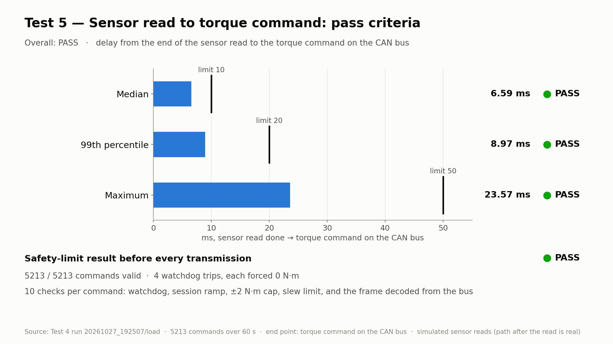
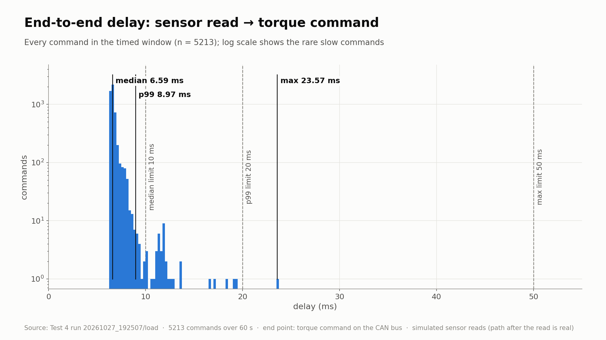
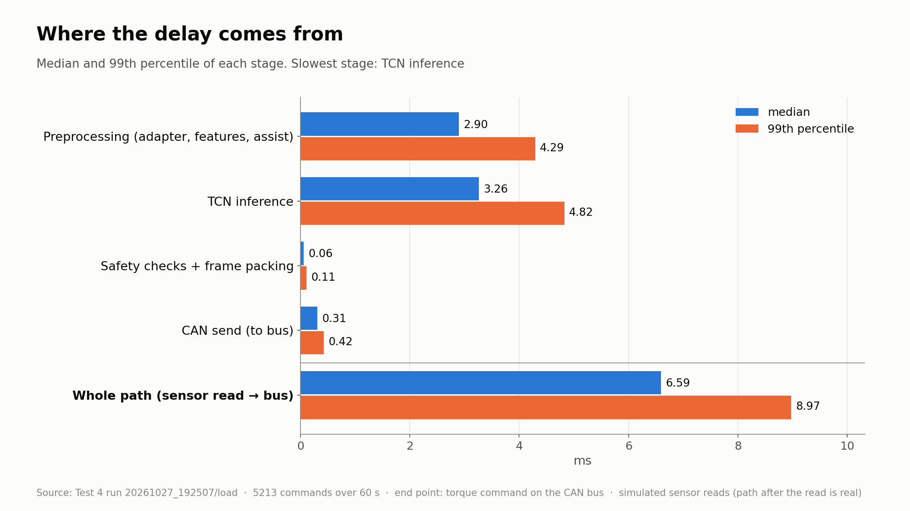
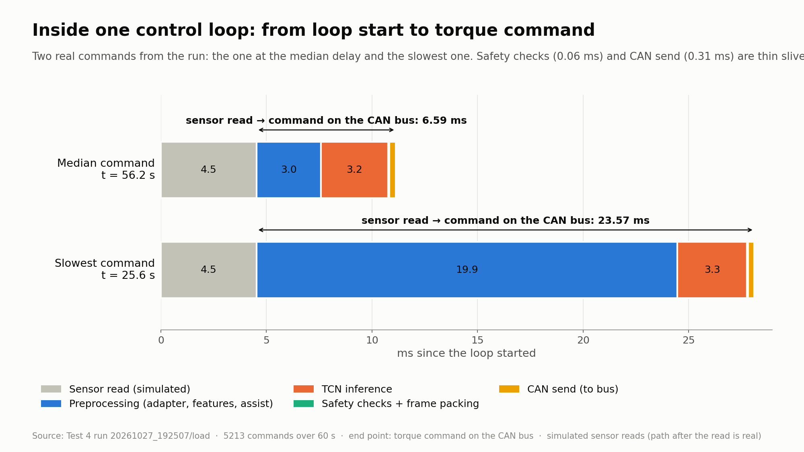
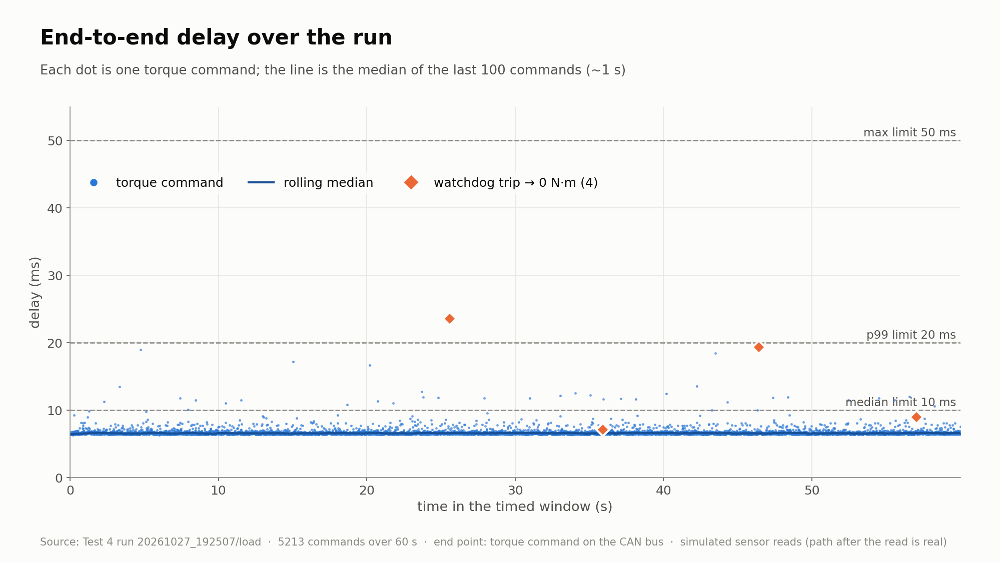
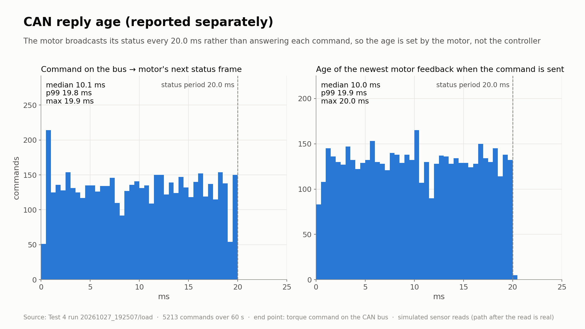

# Test 5 — End-to-end latency: sensor read to torque command (R-05)

**Verdict: PASS**

- Source: Test 4 load run `/home/axilles/exo_ws/fall_test_plan/test_4/results/20261027_192507/load` (status `completed`, 60 s timed window; the test plan asks for 600 s)
- **SIMULATED SENSORS**: the sensor reads were placeholder waits ({'imu_both': 1.4, 'fsr_enc': 3.0} ms). The delay measured here starts when the read ends, so it covers only real work (controller, TCN, safety checks, CAN). Repeat on a Test 4 run with the sensors connected for the final result.
- Gait injection was on: the controller ran on a recorded walk while the sensors were read every loop. The timing path is the same.
- Controller: TCN `/home/axilles/exo_ws/ML_model/runs/deploy`, backend `onnx`; torque mode `zero`; 100 Hz, scheduler `relative`, logger `buffered`
- Jetson: NVIDIA Jetson Orin Nano Engineering Reference Developer Kit Super; NV Power Mode: 25W; governor ['schedutil']
- Delay measured from the end of the loop's sensor read to the torque command **on the CAN bus** (matched (FIFO, equal counts))

| Criterion | Measured | Limit | Result |
|---|---|---|---|
| Median sensor-read-to-CAN-send delay | 6.59 ms | <= 10 ms | **PASS** |
| 99th-percentile delay | 8.97 ms | <= 20 ms | **PASS** |
| Maximum delay | 23.57 ms | <= 50 ms | **PASS** |
| Every torque command has a valid safety-limit result before transmission | 5213 / 5213 commands | all | **PASS** |

## Script output

5213 commands in a 60.0 s window (5213 timed loops, 0 without exactly one command).

| Stage | median | p99 | max | mean |
|---|---|---|---|---|
| Preprocessing (adapter, features, assist) | 2.899 | 4.292 | 19.937 | 2.991 |
| TCN inference | 3.260 | 4.824 | 15.433 | 3.379 |
| Safety checks + frame packing | 0.058 | 0.106 | 1.197 | 0.060 |
| CAN send (to bus) | 0.307 | 0.424 | 5.096 | 0.310 |
|   bus.send() call | 0.151 | 0.267 | 4.946 | 0.154 |
|   send() return -> on the bus | 0.156 | 0.183 | 0.296 | 0.157 |
| **Sensor read → command on the CAN bus** | **6.590** | **8.971** | **23.573** | **6.740** |
| Sensor read → send() return | 6.432 | 8.818 | 23.419 | 6.583 |
| (context) sensor read itself | 4.538 | 6.016 | 21.999 | 4.607 |

All times in ms. The stages add up exactly to the whole path.

**Slowest stage:** TCN inference by median, TCN inference by p99. Share of the time in the slowest 1 % of commands: Preprocessing (adapter, features, assist) 47 %, TCN inference 49 %, Safety checks + frame packing 1 %, CAN send (to bus) 3 %.

Five slowest commands:

| t (s) | total | preprocessing | TCN | safety + packing | CAN send | watchdog |
|---|---|---|---|---|---|---|
| 25.6 | 23.57 | 19.94 | 3.28 | 0.06 | 0.29 | trip |
| 46.4 | 19.36 | 3.51 | 15.43 | 0.08 | 0.33 | trip |
| 4.7 | 19.02 | 15.17 | 3.48 | 0.06 | 0.31 |  |
| 43.5 | 18.44 | 3.03 | 14.99 | 0.08 | 0.34 |  |
| 15.0 | 17.23 | 13.63 | 3.21 | 0.06 | 0.33 |  |

## Safety-limit result per command

5213 of 5213 commands passed every check (cap ±2 N·m, sign -1, slew 10.0 N·m/s, watchdog 25 ms, session ramp 5.0 s). 4 watchdog trips, each forcing 0 N·m.

| Check | Failures |
|---|---|
| exactly one command frame sent, no send error | 0 |
| assist, target and sent torque are finite numbers | 0 |
| watchdog decision matches the work time measured before the send | 0 |
| a watchdog trip forced the target to 0 N·m | 0 |
| target = assist × session ramp (when the watchdog did not trip) | 0 |
| sent torque within the torque cap | 0 |
| sent torque = sign, cap and slew limit applied to the target | 0 |
| torque decoded from the frame on the bus within the cap | 0 |
| torque decoded from the frame on the bus = logged sent torque | 0 |
| frame on the bus has kp = kd = 0 (pure torque command) | 0 |

The checks recompute each command's safety result from the logged inputs and compare it with what `send_torque()` returned and with the frame decoded from the bus. The watchdog uses the work time measured before the send, so its decision is made before transmission.

## CAN reply age (reported separately, not scored)

The motor sends status frames (0x2968) at 49.97 Hz, every 20.00 ms (std 0.051 ms), whatever the command rate. It does not answer each command, so a command is matched to the next status frame after it.

| Reply age | median | p99 | max |
|---|---|---|---|
| Command on the bus → next motor status frame | 10.07 | 19.82 | 19.93 |
| Age of newest motor feedback when send() starts | 10.02 | 19.85 | 20.05 |

Motor status during the window: max |current| 0.08 A, max temperature 38 °C, error codes [0]. The controller does not use motor feedback yet, so the reply age does not add to the command delay.

## Plots

